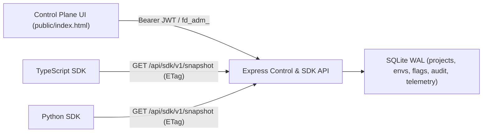

# FeatureDock

Self-hosted feature flag and controlled rollout platform with targeting rules, reusable segments, percentage rollouts, kill switches, and TypeScript & Python SDKs.

## Overview & Problem Statement

Shipping new capabilities safely requires separating code deployment from feature exposure. FeatureDock provides a self-hosted Express + SQLite control plane with multi-environment versioning, deterministic consistent-hashing percentage rollouts, emergency kill switches, full audit diffs, and lightweight TypeScript and Python SDKs with local snapshot caching.

## Features

- **Projects, Environments & Config Versioning**: Automatic `development`, `staging`, and `production` environments per project with scoped `fd_sdk_` keys and `ETag` (`304 Not Modified`) snapshot sync.
- **Rich Flag Types & Evaluation**: Supports `boolean`, `string`, `number`, and `json` flags evaluated across kill switches, user targets, group targets, segments, custom rules, and deterministic SHA-256 percentage rollouts.
- **RBAC, Tokens & Audit History**: JWT/scrypt user accounts (`admin`, `editor`, `viewer`), `fd_adm_` API tokens, before/after audit diffs, and SDK telemetry tracking.
- **TypeScript & Python SDKs**: Built-in `FeatureDock` (TypeScript) and `FeatureDockClient` (Python) clients with local TTL caching.

## Quick Start

1. **Requirements**: Node.js 22.5+ (Python 3.11+ optional for Python SDK)
2. **Clone**: `git clone https://github.com/fully-ai/featuredock.git && cd featuredock`
3. **Install & Build**: `./scripts/install.sh` (Windows: `.\scripts\install.ps1`)
4. **Configure**: Copy `.env.example` to `.env` if setting `FEATUREDOCK_JWT_SECRET` or `FEATUREDOCK_PORT`
5. **Start**: `./scripts/dev.sh` (Windows: `.\scripts\dev.ps1`)
6. **Open Dashboard**: `http://127.0.0.1:8096`
7. **Run Tests**: `./scripts/test.sh` (Windows: `.\scripts\test.ps1`)
8. **Stop**: `Ctrl+C` (or `docker compose down`)

## SDK Usage

### TypeScript (`sdk/typescript`)

```typescript
import { FeatureDock } from "./sdk/typescript/dist/index.js";

const client = new FeatureDock({
  apiUrl: "http://127.0.0.1:8096",
  sdkKey: process.env.FEATUREDOCK_SDK_KEY!
});

const enabled = await client.isEnabled(
  "new-dashboard",
  { userId: "user-123" }
);
```

### Python (`sdk/python`)

```python
from featuredock_sdk import FeatureDockClient

client = FeatureDockClient("http://127.0.0.1:8096", sdk_key="fd_sdk_...")
enabled = client.is_enabled("new-dashboard", {"userId": "user-123"})
```

## Architecture



## Docker Deployment

```bash
FEATUREDOCK_JWT_SECRET="replace-with-strong-secret" docker compose up --build -d
docker compose logs -f
docker compose down
```

## Contributing & License

See [CONTRIBUTING.md](CONTRIBUTING.md), [SECURITY.md](SECURITY.md), and [LICENSE](LICENSE) (Apache 2.0).
